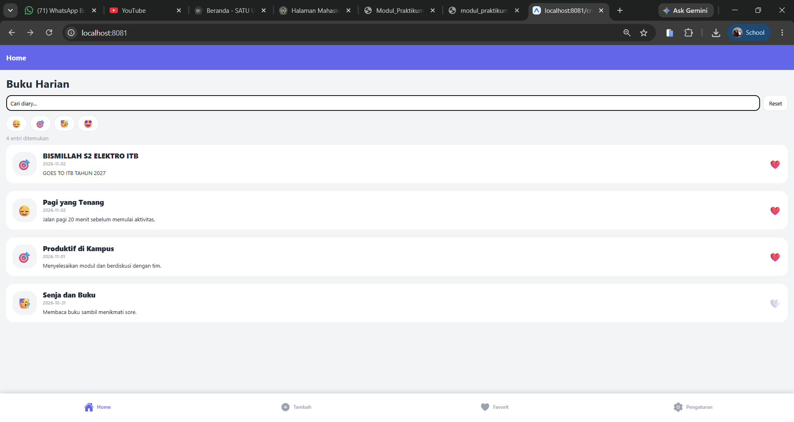
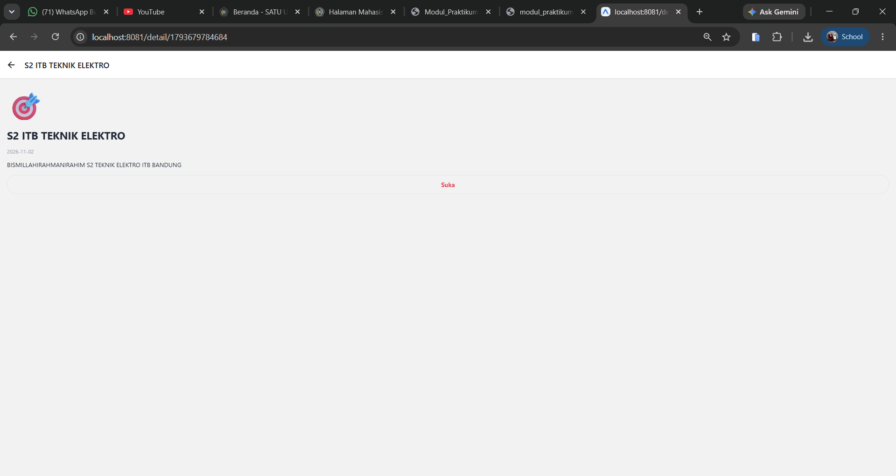
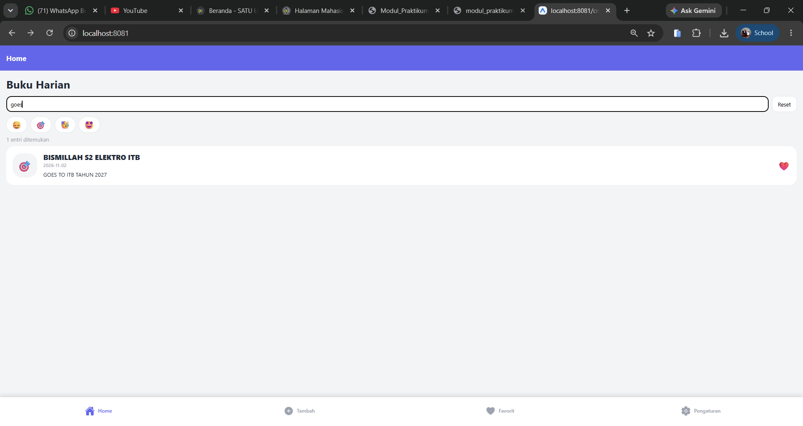
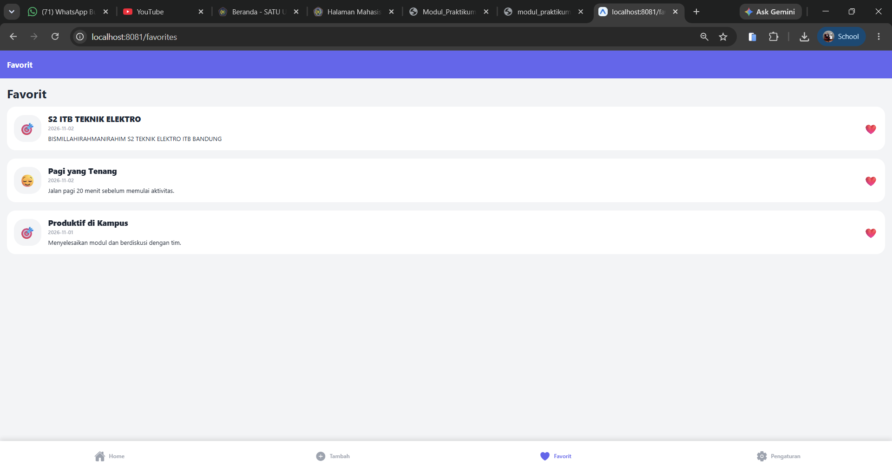
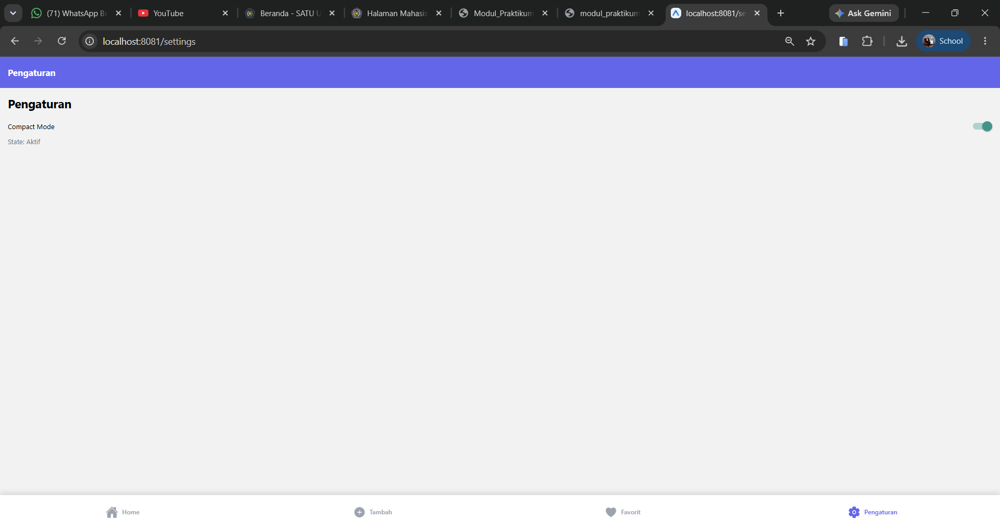

# Laporan Praktikum 6: State dan Hooks pada React Native (Diary App)

**Mata Kuliah:** Mobile Programming

**Nama:** Muhammad Hafizh Akbar Solehudin

**NIM:** 2430511012

**Link Repository GitHub:** https://github.com/hafizhakbar3105/diary-app6-hafizh-2430511012.git

## 🛠️ Penjelasan 5 React Hooks yang Digunakan

| Hook              | Input                                                                               | Output                                                                          | Dependency                              | Alasan Pemilihan                                                                                                                                                                                      |
| ----------------- | ----------------------------------------------------------------------------------- | ------------------------------------------------------------------------------- | --------------------------------------- | ----------------------------------------------------------------------------------------------------------------------------------------------------------------------------------------------------- |
| **`useState`**    | Nilai awal (contoh: `''` untuk query pencarian, atau status `false` pada Settings). | Array berisi _current state_ dan fungsi _setter_ (contoh: `[query, setQuery]`). | _Tidak ada_                             | Digunakan untuk mengelola _local state_ komponen. Ketika nilai diubah melalui setter, komponen akan otomatis di-render ulang. Sangat cocok untuk input form, filter mood, dan toggle.                 |
| **`useContext`**  | Objek Context (yaitu `DiaryContext`).                                               | Nilai context saat ini (data `entries`, `likedIds`, fungsi `toggleLike`).       | _Tidak ada_                             | Digunakan untuk membagikan data (_shared state_) lintas layar (Home, Detail, Favorites) tanpa harus melakukan _prop-drilling_. Fitur Like otomatis sinkron di semua halaman.                          |
| **`useEffect`**   | Fungsi _callback_ (efek) dan array dependensi.                                      | _Cleanup function_ (opsional, seperti `clearTimeout`).                          | `[query]`                               | Digunakan untuk menangani _side effect_, khususnya membuat _timer_ (`setTimeout`) pada fitur _debounce_ pencarian. Jika user mengetik lagi sebelum 350ms, timer lama dibatalkan.                      |
| **`useMemo`**     | Fungsi kalkulasi yang mengembalikan nilai, dan array dependensi.                    | Nilai hasil kalkulasi (contoh: `filteredEntries`).                              | `[entries, debouncedQuery, moodFilter]` | Digunakan untuk mengoptimalkan performa. Array _diary_ hanya akan difilter ulang jika ada perubahan pada data _entries_, teks pencarian, atau filter mood.                                            |
| **`useCallback`** | Fungsi _callback_ dan array dependensi.                                             | Fungsi yang referensinya tetap (stabil).                                        | `[router]`, `[setQuery]`                | Mencegah pembuatan ulang fungsi seperti `openDetail` dan `resetFilter` setiap kali layar di-render ulang. Sangat berguna agar komponen anak (seperti `DiaryCard`) tidak ikut ter-render tanpa alasan. |

## 📸 Lampiran Output (Screenshot)

### 1. Tampilan Home & Search

### 2. Tampilan Detail Diary

### 3. Tampilan Tambah Diary (Create)

### 4. Tampilan Favorites

### 5. Tampilan Settings

